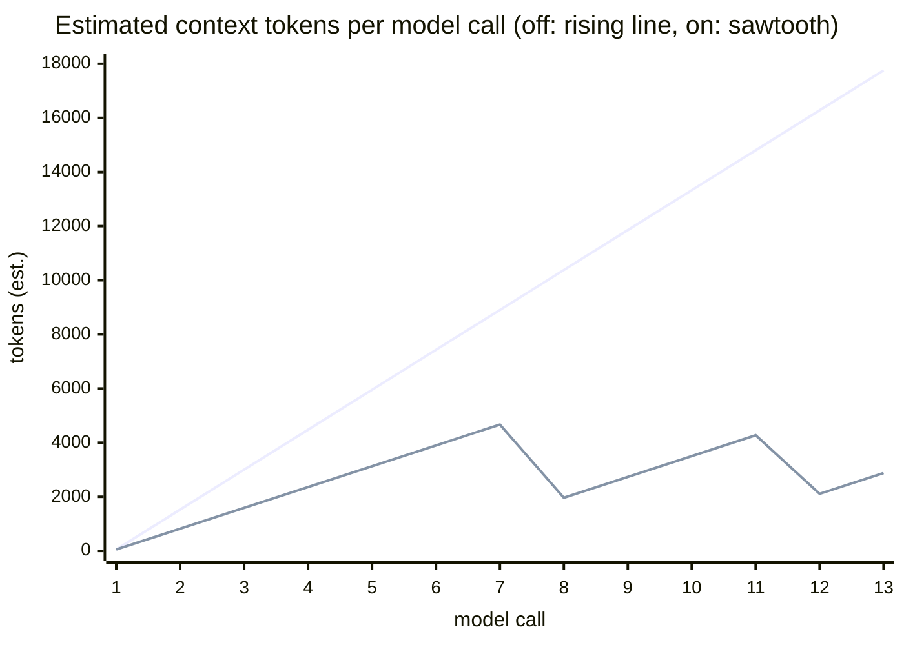

# RESULTS

Every number has: commit, environment, command. NOT MEASURED means exactly that.

## Phase 0

| Metric | Value | Env | Command | Commit |
|---|---|---|---|---|
| Unit tests | 11 passed | sandbox, py3.12 | `uv run pytest -q` | 7536ef3 |
| Compose core+obs boot to healthy (images cached) | 16 s | cloud sandbox, 4 vCPU / 15 GB | `compose up --wait` | 7536ef3 |
| Compose core+obs+llmobs boot to healthy, fresh volumes | 25 s | same | `scripts/compose_smoke.sh --llmobs` | 7536ef3 |
| /healthz latency, sequential, n=1000 | p50 1.41 ms, p95 1.79 ms, p99 2.22 ms | same, host -> container | `scripts/bench_probes.py` | 7536ef3 |
| /readyz latency (PG via PgBouncer + Redis), n=1000 | p50 10.67 ms, p95 14.24 ms, p99 16.77 ms | same | same | 7536ef3 |
| /v1/ping (traced) latency, n=1000 | p50 1.68 ms, p95 3.12 ms, p99 8.47 ms | same | same | 7536ef3 |
| Spans: API -> collector -> Langfuse v4 | observations visible via /api/public/v2/observations | same | smoke script | 7536ef3 |
| pip-audit (runtime deps) | no known vulnerabilities | sandbox | `pip-audit -r <uv export>` | 7536ef3 |
| CI (ci, compose-smoke, security) | NOT MEASURED yet: first run on the PR | GitHub Actions | | |

## Phase 1A: retrieval

SciFact slice: BEIR SciFact test (files from the `mteb/scifact` Hugging Face mirror), first 200 queries by id, 1500 docs = all relevant docs + seeded (13) distractors. Chunks 96 words / 16 overlap. Embedder `BAAI/bge-small-en-v1.5` (384-d), reranker `Xenova/ms-marco-MiniLM-L-6-v2`, both CPU via fastembed. FTS is Postgres `ts_rank_cd`, not BM25. Doc-level metrics, bootstrap 95% CIs. Latency is end-to-end per query on a GitHub-hosted runner (shared CPU, noisy).

Run: [eval-retrieval #12, attempt 2](https://github.com/pavankalyan-Maturi/Ai_Agent_Production/actions/runs/45894089753), commit 7b13dc9, `uv run python -m evals.retrieval.run --queries 200 --corpus-size 1500` (naive rows identical to run #8 at 579a163). Contextual headers: `claude-haiku-5-5`, effort low, thinking off, prompt v2.

| Variant | Retrieval | Recall@20 [95% CI] | Failure@20 | nDCG@10 [95% CI] | p50 / p95 ms |
|---|---|---|---|---|---|
| naive | dense | 0.925 [0.890, 0.958] | 0.075 | 0.796 [0.748, 0.837] | 54 / 64 |
| naive | hybrid (RRF k=60) | 0.939 [0.906, 0.969] | 0.061 | 0.776 [0.729, 0.819] | 84 / 122 |
| naive | hybrid + rerank (50 → 20) | 0.947 [0.917, 0.974] | 0.053 | 0.808 [0.764, 0.848] | 1767 / 2825 |
| contextual | dense | 0.905 [0.864, 0.943] | 0.095 | 0.797 [0.748, 0.839] | 31 / 45 |
| contextual | hybrid | 0.927 [0.892, 0.959] | 0.073 | 0.792 [0.746, 0.836] | 81 / 124 |
| contextual | hybrid + rerank | 0.942 [0.910, 0.972] | 0.058 | 0.805 [0.761, 0.846] | 1729 / 2790 |

Contextual generation: 4,522 Haiku calls, 2.11M uncached input, 0.44M cache-write, 1.49M cache-read, 0.53M output tokens; est. $0.67 (ESTIMATE, from usage at list price; actual billing not read).

Reading: every CI overlaps. Contextual headers did not help on SciFact: recall@20 is 0.012-0.020 lower in each rung, nDCG@10 flat (not significant either way). Likely cause (UNVERIFIED): SciFact docs are single short abstracts with the title already prepended to every chunk, so the extra context adds little and dilutes the 384-d embedding. Hybrid and rerank are not significantly better than dense; rerank costs ~20-30x latency on CPU.

Filtered ANN (tenant filter on a shared HNSW index), `tests/retrieval/test_store_integration.py`, local sandbox, pgvector 0.8.6, 20k rows big tenant + 200 rows small tenant, k=10:

| Setting | Recall@10 (small tenant) | Mean rows returned |
|---|---|---|
| `hnsw.iterative_scan=off` | 0.015 | 0.1 of 10 |
| `hnsw.iterative_scan=relaxed_order`, ef_search 100, max_scan_tuples 20000 | 0.845 | 10 of 10 |

Commit 7364b2c, `PAP_TEST_DATABASE_URL=... uv run pytest -m integration -s`. CI asserts on ≥ 0.75, off < 0.2.

## Phase 1B: ingestion

`tests/ingest/test_ingest_integration.py`, local sandbox (4 vCPU), RabbitMQ 4.2 + pgvector 0.8.6 containers, S3 = moto server, in-process Celery worker (threads, concurrency 4), hash embedder (so this measures the pipeline, not embedding). Command: `PAP_TEST_DATABASE_URL=... PAP_TEST_BROKER_URL=... uv run pytest -m integration tests/ingest -s`.

| Metric | Value |
|---|---|
| 40 docs (300 words each) + 4 poison, enqueue → all jobs terminal | 1.56-1.64 s (≈25 docs/s), 160 chunks |
| Poison docs in `ingest.dlq` | 4 / 4 (binary, empty, oversize, missing) |
| Duplicate enqueues suppressed | 10 / 10 |
| Redelivered message for a done job | 0 new chunks, attempts stays 1 |
| Transient S3 error ×2 | done on attempt 3 |

First run on a fresh database lost one message: a migration race (fixed, ADR 003; repro 5/5 trials with UniqueViolation before, 0 after; regression test `test_concurrent_migrate_is_safe`). CI ([integration, 251a7b5](https://github.com/pavankalyan-Maturi/Ai_Agent_Production/actions/runs/45902058992/job/140189945175), fresh DB + broker): 40 docs + 4 poison in 0.98 s (41 docs/s), DLQ 4/4, dedupe 10/10, retry ×2 → done on attempt 3; same run's filtered-ANN test recall@10 off 0.020 → on 0.830. Throughput with the real fastembed model: NOT MEASURED.

## Phase 2A: agent loop, checkpointing, budgets, HITL

`scripts/bench_agent.py -n 50 --kills 10`, local sandbox (4 vCPU), pgvector 0.8.6 container (Postgres 17), scripted model (no LLM: this measures the graph and the checkpointer). Each run is 10 calculator tool steps, which is 22 graph super-steps.

| Metric | Value |
|---|---|
| Run latency, InMemorySaver, p50 | 19.8 ms |
| Run latency, AsyncPostgresSaver, p50 / p95 | 67.8 / 81.5 ms |
| Checkpoint overhead per super-step, p50 | ≈2.2 ms |
| SIGKILL inside a tool step, then resume from Postgres | 10 / 10 finished with the correct answer |
| Resume to completion (2 remaining steps), p50 / max | 23 / 30 ms |

Tests (`tests/agent/`):
- Kill and resume: the run resumes at `act`, steps 0-1 do not re-run, the killed step re-runs once (at-least-once), and the answer is correct.
- HITL across two savers: no tool runs before approval, and the run resumes from a fresh connection.
- Budgets: steps, tokens and USD (Sonnet 5.5 price) each stop after the 3rd call and return a marked partial answer.
- Tenant: the tenant comes from state even when the model supplies one; `search` and `fetch_doc` never return another tenant's document.

A real model's planning quality: NOT MEASURED (no live LLM calls in this PR). Integration numbers in CI: see the PR's `integration` job.

## Phase 2B: compaction, durability fix, memory ablation

**Checkpoint durability (fix to Phase 2A).** `tests/agent` kill/resume, 30 trials each, local Postgres 17. With LangGraph's default `durability="async"`, 8 of 30 runs had no checkpoint to resume after SIGKILL. With `durability="sync"` (now always passed), 0 of 30 failed. The Phase 2A figure of 10/10 was measured with the default and was luck.

`scripts/bench_agent.py -n 50 --kills 30`, after the fix:

| Metric | Value |
|---|---|
| Run p50, InMemorySaver / AsyncPostgresSaver (sync) | 21.1 / 74.7 ms (p95 84.0) |
| Checkpoint overhead per super-step, p50 | ≈2.4 ms (2.2 ms with async) |
| SIGKILL inside a tool step, then resume | 30 / 30 correct |
| Resume to completion, p50 / max | 19 / 53 ms |

**Context compaction (P2.4).** `scripts/token_chart.py`: scripted model, 12 search results of ~6 kB each, `CompactionPolicy(tool_result_chars=3000, threshold_tokens=5000, keep_last=4)`. Token counts are estimates (4 chars per token).

| | Peak view | Sum over run |
|---|---|---|
| Compaction off | 17,755 | 115,739 |
| Compaction on | 4,668 | 33,979 (−71%) |

The answer was the same in both, and the transcript kept every message. Effect on answer quality with a real model: covered only indirectly by the ablation below (all arms run with compaction on); off vs on with a real model is NOT MEASURED.

**Experience memory ablation (P2.5).** HotpotQA distractor validation, first 100 questions, 991 paragraphs, Claude Haiku 5.5, `eval-agent` workflow.

Run 1 ([job](https://github.com/pavankalyan-Maturi/Ai_Agent_Production/actions/runs/45915156307/job/140232480323), commit 6da6a94, $0.28, 1260 calls). Setup: recall top 3 at cosine ≥ 0.3; every run distilled (success if F1 ≥ 0.8, else failure); the gate replayed the *source* question.

| Arm | EM | F1 | F1 (2nd half) | ΔF1 vs off [95% CI] | Steps | Tokens/q | Memory | Gate |
|---|---|---|---|---|---|---|---|---|
| off | 0.300 | 0.483 | 0.532 | - | 2.52 | 4071 | 0 | - |
| on | 0.230 | 0.392 | 0.417 | −0.091 [−0.160, −0.023] | 2.58 | 5443 | 130 | - |
| gated | 0.260 | 0.421 | 0.457 | −0.062 [−0.132, +0.010] | 2.68 | 5689 | 54 | admitted 54, replay_worse 75, answer_leak 4, duplicate 1 |

Reading: ungated memory made answers significantly worse. The gate removed about 60% of the items and recovered a third of the loss, but gated is still below off, so eval-gate:agent failed (as designed). Likely causes (UNVERIFIED):
- A floor of 0.3 is below the typical cosine between unrelated questions with bge-small, so 3 lessons were injected into every question.
- About half the runs had partial F1 (0.2-0.8), mostly answer phrasing, and were distilled as "failures", producing wrong pitfalls.
- Replaying the source question admits items that only fit that question.

Run 2 ([job](https://github.com/pavankalyan-Maturi/Ai_Agent_Production/actions/runs/45915984763/job/140235191815), commit 9a7ea83, $0.20, 955 new calls). Setup: recall top 2 at ≥ 0.6, distil only clear outcomes (F1 ≥ 0.8 or ≤ 0.2), gate replays the nearest *other* question (a transfer test). Run 1's response cache was not saved (failed jobs don't save caches), so the off arm re-ran live.

| Arm | EM | F1 | F1 (2nd half) | ΔF1 vs off [95% CI] | Steps | Tokens/q | Memory | Gate |
|---|---|---|---|---|---|---|---|---|
| off | 0.310 | 0.479 | 0.490 | - | 2.57 | 4213 | 0 | - |
| on | 0.290 | 0.445 | 0.464 | −0.033 [−0.097, +0.026] | 2.54 | 4480 | 112 | - |
| gated | 0.260 | 0.444 | 0.470 | −0.034 [−0.082, +0.012] | 2.50 | 4318 | 47 | admitted 47, replay_worse 51, answer_leak 3 |

Reading:
- Neither memory arm is significantly different from no memory. The CIs include 0, and the point estimates are still slightly negative.
- The gate admitted 47 of 101 candidates and kept tokens near the off arm (4318 vs 4213 per question). The loss is no longer significant, but there is no gain.
- The off arm moved 0.483 → 0.479 between runs with identical code, which is the run-to-run noise of the model.
- eval-gate:agent passed (gated ≥ off − 0.05).

**Conclusion: experience memory does not help Haiku 5.5 on this HotpotQA slice. It stays off by default.** It is available, gated, for workloads where an eval shows a gain. Likely limits (UNVERIFIED): HotpotQA questions rarely share entities, so "strategy" lessons are generic, and the base loop is short (2.5 steps). A first-half/second-half split of 50 questions each is also small.

Mean estimated context tokens per model call, real model (arm off, compaction on, run 2): 104, 865, 1345, 1650, 1686. Runs are short, so compaction rarely triggers here.

Total Haiku spend for the ablation: $0.48 (run 1 $0.28 + run 2 $0.20).

## Phase 3A: tool governance (mcp-rbac-gateway 0.2.0)

`scripts/bench_governance.py -n 2000`, local sandbox (4 vCPU), SQLite audit on local disk. The tool is the calculator (4 µs), so these numbers are the gateway's own cost.

| Path | p50 | p95 |
|---|---|---|
| Raw tool call | 3.9 µs | |
| Governed, allowed (policy, scans, audit write) | 2.08 ms | 2.63 ms |
| Governed, denied by policy (with audit write) | 1.81 ms | |
| Output scan alone, 2 kB result | 0.94 ms | |

Tests (`tests/security/test_governance.py`, real `sentinel.yaml`), all passing locally:
- An allowed call runs. Its output PII is redacted, and it is audited per tenant with the tool-call id.
- A researcher → `create_ticket` call is blocked without an approval pause, and the model is never offered the tool.
- Argument regexes block `__import__`, `../` and priority values outside low/medium/high.
- With no role, every tool is denied.
- Secrets in arguments are redacted before the tool runs.
- An injected tool output is blocked, and the model never sees it.
- An operator `create_ticket` pauses, then runs on approval, with `alice` recorded as approver. A rejection is audited as `denied_by_human`.
- A direct call waits on `/api/v1/security/approvals` and runs after approval.
- The API returns 503 with no key, 401 with a wrong key, and only that tenant's audit rows.
- Integration (Postgres): `create_ticket` is idempotent and tenant-scoped.

## Phase 3B: MCP server + gateway

Run with `scripts/bench_mcp.py -n 1000` in the local sandbox. Transports are in-process ASGI, the fake tool costs nothing, and the audit is SQLite. The numbers cover protocol, auth and gateway cost only, with no network or retrieval.

| Path (SDK client, mode 2026-07-28, `tools/call`) | p50 | p95 |
|---|---|---|
| Direct to the MCP server | 2.63 ms | 3.70 ms |
| Through mcp-rbac-gateway StatelessHttpProxy | 6.07 ms | 7.85 ms |

Tests (`tests/mcp/`) all pass locally: 23 unit tests and 1 integration test against Postgres.

**Server, direct**
- **SDK client, all three modes.** `auto` negotiates 2026-07-28, a pinned `2026-07-28` works, and `legacy` negotiates 2025-11-25. In every mode list_tools and call_tool succeed.
- **Tenant.** It comes only from the token. A `tenant_id` argument is ignored.
- **Bad tokens.** Each of these is rejected (401, or 403 for scope) and no tool runs:
  - no token
  - wrong audience or issuer
  - expired
  - bad signature
  - bad or missing tenant
  - missing scope

  The 401 carries `resource_metadata`. RFC 9728 metadata lists the resource, the issuer (exact, no trailing slash) and the scope.
- **Stateless replicas.** Two independent replicas sit behind a round-robin transport with no affinity. Six calls succeeded and both replicas served at least 3 requests. The kind e2e is NOT RUN.

**Through the gateway**
- **Researcher.** Allowed. The OAuth `Authorization` header is forwarded and `X-Sentinel-Token` is not. `_meta` (protocol version, `traceparent`) arrives upstream unchanged. The audit row is `researcher / search / allowed / http-stateless` with the same trace id.
- **Redaction.** PII in results comes back as `[REDACTED:email]`.
- **No role token.** No tools are listed, and calls are blocked (`anonymous` / blocked_policy). A wrong role token gets 401.
- **Blocks.** `../` in doc_id → blocked_policy. An injected output → blocked_injection, and the injected text never reaches the client.
- **Header/body mismatch.** The call gets 400 with error -32020 and nothing is forwarded upstream.
- **Approvals.** The gateway's `/approvals` needs its token, and the gateway refuses to start without one.

**Integration (Postgres)** Real hybrid search through the gateway and server is tenant-scoped: tenant A never sees tenant B's documents.

## Phase 3C: A2A + tool retrieval

### A2A (tests/a2a, 10 tests, all passing locally)
- **Card verification passes.** The signed card was fetched by the SDK's `A2ACardResolver` and verified with an ES256 key from our JWKS. It has a JSONRPC interface, the `grounded-qa` skill, Bearer JWT security and the `pap:agent` scope.
- **Bad cards are rejected:**
  - a tampered interface URL → InvalidSignaturesError
  - signatures removed → NoSignatureError
  - a forged key under the same kid → rejected
  - an untrusted jku → rejected
  - the JWKS has no private component
- **SendMessage works end to end.** The SDK client ran the agent as the token's tenant and got a completed task with the cited answer. The governance audit shows `researcher / search / allowed`.
- **Tasks are isolated per tenant.** Another tenant's `GetTask` on the same id gets "not found".
- **RPC auth:** no token, a garbage token or an MCP-audience token → 401. The wrong scope → 403. No tool runs in any of these cases.

### Tool-count scaling (`python -m evals.tools.run`, hash embedder, local)

k=5:

| tools | queries | recall@k | spec tokens, all | spec tokens, top-k | select p50 |
|---|---|---|---|---|---|
| 10 | 9 | 0.889 | 302 | 153 | 0.03 ms |
| 25 | 24 | 0.917 | 738 | 146 | 0.04 ms |
| 50 | 49 | 0.959 | 1499 | 148 | 0.07 ms |
| 100 | 99 | 0.889 | 2988 | 148 | 0.11 ms |
| 163 | 162 | 0.642 | 4858 | 145 | 0.17 ms |

k=10:

| tools | queries | recall@k | spec tokens, all | spec tokens, top-k | select p50 |
|---|---|---|---|---|---|
| 10 | 9 | 1.000 | 302 | 302 | 0.00 ms |
| 25 | 24 | 1.000 | 738 | 293 | 0.04 ms |
| 50 | 49 | 0.980 | 1499 | 294 | 0.07 ms |
| 100 | 99 | 0.970 | 2988 | 297 | 0.12 ms |
| 163 | 162 | 0.969 | 4858 | 295 | 0.18 ms |

- **Token counts** are estimates (spec JSON chars / 4), not a tokenizer.
- **Embedders:** the tables above use the lexical hash embedder (local). CI `eval-tools` repeated the run with fastembed BAAI/bge-small-en-v1.5 (PR #8, run 45922320083):

| tools | recall@5 | recall@10 | spec tokens, all | top-5 | top-10 | select p50 |
|---|---|---|---|---|---|---|
| 10 | 1.000 | 1.000 | 302 | 152 | 302 | 6.6 ms |
| 25 | 0.958 | 0.958 | 738 | 150 | 299 | 6.8 ms |
| 50 | 0.980 | 0.980 | 1499 | 151 | 302 | 6.6 ms |
| 100 | 0.980 | 0.990 | 2988 | 148 | 300 | 10.1 ms |
| 163 | 0.963 | 0.994 | 4858 | 145 | 298 | 7.0 ms |

  The semantic embedder removes most of the near-duplicate failures that the lexical one has at k=5. Query embedding takes about 7 ms on CPU.

**HotpotQA (eval-agent) on PR #8, first run:** off 0.487 / on 0.432 / gated 0.403 F1. The gate failed (gated −0.084, 95% CI [−0.139, −0.034]). That run made 933 fresh Haiku calls ($0.19) because the response cache was not reachable from a new PR. The memory path was not changed in this PR; the memory arms are noisy across fresh samples (PR #5 run 2: gated −0.035). The fix is that main now seeds the cache and red runs save it, so unchanged prompts reproduce instead of re-rolling.
- **Not measured:** end-to-end task success with a real model (NOT MEASURED).

## Phase 5A: guardrails at the edges, spotlighting, OIDC auth
Command: `uv run python -m evals.security.run` (offline; ran here). Model arms: CI `eval-security`.

| family | gateway scanner detected |
|---|---|
| direct_override | 100% |
| fake_markup | 100% |
| role_override, exfil_tool, paraphrase, authority, multilingual, encoded | 0% |
| **all 40 injected docs** | **25%** |
| false blocks on 20 benign docs | 0% |

- Latency: governed tool call p50 1.47 ms / p95 1.94 ms (n=300). PII redaction p50 0.04 ms/doc.
- Attack success rate (Haiku 5.5, CI `eval-security` on PR #9, $0.01): none **38%**, scanner
  **25%**, scanner+spotlight **18%**. Paraphrase (60%) and authority-style (40%) attacks still
  leaked with spotlighting on.
- What did not replicate: spotlighting by delimiting halves ASR, short of the near-zero the
  paper reports for its strongest (encoding) variant. The heuristic scanner misses most families.

## Phase 5B: plan/data separation + taint (CaMeL-lite), step + trace tool-call policy (ADR 010)
Command: `uv run python -m evals.security.run` (offline + scripted; ran here). Suite now 70 cases:
40 attacks, 20 benign, 10 benign_action (the user asks for a ticket) for false blocks.

Scripted worst case (the model obeys every injection it can read; no spend):

| arm | ASR | exfil ASR | answer ASR | benign acc | ticket asks done | false blocks (30) |
|---|---|---|---|---|---|---|
| none | 100% | 100% | 100% | 100% | 100% | 0% |
| policy (step + trace) | 88% | 0% | 100% | 100% | 100% | 0% |
| camel (plan/data + policy) | 0% | 0% | 0% | 100% | 100% | 0% |

- Latency: policy check p50 0.014 ms / p95 0.025 ms per step (n=300). The quarantined reader adds
  one model call per `extract` (Haiku cost and latency: CI).
- Haiku 5.5 ASR, benign accuracy, ticket success and false blocks for all 5 arms: NOT MEASURED
  here; read the `eval-security` job summary on the PR B run.
- Limits: the policy alone does nothing for answer-text attacks; camel's 0% on answers depends on
  typed validation and would not hold for the `text` type.
